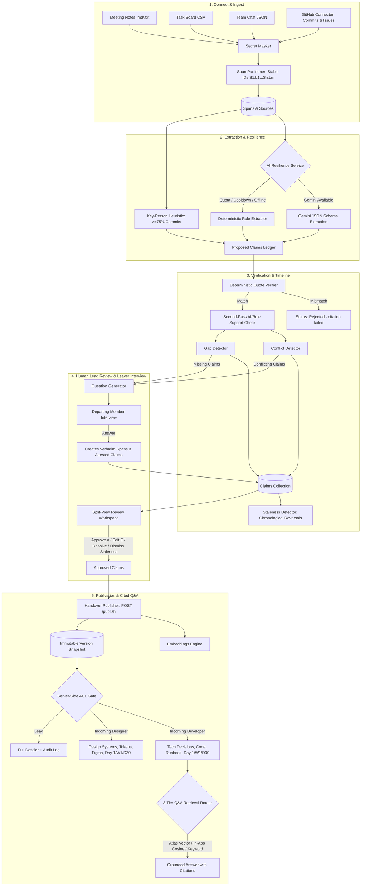

# Relay — Evidence-Linked Knowledge Handover Platform

> **Hackathon Round 3: "The Build"**  
> **Team:** Tech Force  
> **Problem Statement:** *"Prevent Critical Knowledge From Leaving With People."*  
> **Target Users:** Student clubs, hackathon teams, volunteer groups, and small engineering teams.

---

### 🌐 Live Production Deployments & Access
- **Live Web Application (Vercel):** [https://client-cxv9.vercel.app/](https://client-cxv9.vercel.app/)
- **Dedicated Login & Judge Portal:** [https://client-cxv9.vercel.app/login](https://client-cxv9.vercel.app/login) (One-click judge credentials: `demo@techforce.dev` / `Demo@1234`)
- **Live Backend API (Render):** [https://relay-ygyb.onrender.com](https://relay-ygyb.onrender.com)
- **API Health Check:** [https://relay-ygyb.onrender.com/api/health](https://relay-ygyb.onrender.com/api/health)
- **Public GitHub Repository:** [https://github.com/ompaul6767-ctrl/Relay](https://github.com/ompaul6767-ctrl/Relay)
- **Database:** MongoDB Atlas (Live Persistent Cluster with Vector Search Support)
- **Zero Friction Demo:** On-page demo credentials card with 4 instant-switch personas (`Lead`, `Departing`, `Incoming Dev`, `Incoming Designer`).

---

## 1. What Relay Does

When a key team member leaves, their architectural reasoning, in-flight work state, operational runbooks, and critical contacts vanish into fragmented chats, meeting notes, and commit logs.

**Relay solves this through a non-negotiable architectural invariant:**
> **Summaries are never generated directly from raw sources.**
> **Models only propose; code and human leads decide.**

1. **Connect:** Ingests meeting notes, task board CSVs, chat exports, and git repositories. Automatically masks secrets (API keys, credentials, PII) upon ingestion.
2. **Reconstruct:** Splits sources into immutable line-level spans with stable IDs (`S{src}.L{line}`). Proposes atomic claims (one single fact each) citing exact span IDs and verbatim quotes.
3. **Verify & Timeline:** Deterministically verifies citation quotes against source spans with whitespace normalization. Surfaces contradictory claims across sources without auto-picking winners, flags knowledge gaps (`Missing` claims) with suggested contacts, and plots an interactive chronological timeline with automatic staleness detection.
4. **Review & Interview:** A human lead reviews claims side-by-side with highlighted source text. The leaver answers targeted questionnaires to capture unwritten knowledge into Attested claims.
5. **Handover & Q&A:** Publishes immutable, version-controlled handover snapshots with strict server-side ACL filtering. Developers receive technical runbooks and Day 1 / Week 1 / Day 30 milestones; designers receive design tokens and Figma assets; confidential notes are replaced with secure stubs (`isRestrictedStub: true`). Incoming members ask questions via a 3-tier vector retrieval Q&A assistant citing approved claims.

---

## 2. The Three Round 3 Delivered Improvements

### Improvement 1: Gap-Driven Leaver Interview
- **What it does:** Automatically transforms `Missing` claims (unassigned tasks, decisions without rationale, unanswered questions) and `Conflicting` claims into an interactive questionnaire for the departing member.
- **Where to find it:** Switch role to **Departing Member**, click **"Interview"** in the top navigation or stepper (`/cases/:id/interview`).
- **How it works:**
  - Auto-generates targeted questions with conflict quick-pick value buttons and rationale inputs.
  - Submitting an answer creates an immutable span in an `interview` source and links an `Attested` claim with a 100% verified quote.
  - Answers surface in the Lead Review queue tagged *"From leaver interview"*; lead must approve before publication.
  - Skips and unanswered questions remain visible as gaps in the published handover.
  - Strictly isolated: departing members never see questions derived from leads-only confidential claims.

### Improvement 2: Read-Only GitHub Connector & Atlas Vector Search Q&A
- **What it does:** Ingests public repositories into verifiable claims and powers a 3-tier grounded Q&A assistant.
- **Where to find it:**
  - *GitHub Import:* Connect page $\to$ **"Import from GitHub"** tab (`/cases/:id/connect`).
  - *Cited Q&A Assistant:* Handover page $\to$ **"Ask Relay Q&A Assistant"** panel (`/cases/:id/handover`).
- **How it works:**
  - SSRF-protected REST ingestion (`^https://github.com/[A-Za-z0-9_.-]+/[A-Za-z0-9_.-]+$`) fetching latest 100 commits and 50 issues.
  - Conventional commit scope parser feeds module-level Key-Person risk heuristic ($\ge 75\%$ commits).
  - Approved claims are embedded upon publication using `EMBEDDING_MODEL`.
  - Resilient 3-tier retrieval router:
    - *Tier 1:* Atlas Vector Search (`$vectorSearch`) with pre-filters on `caseId`, `accessLabel`, and `reviewDecision: 'approved'`.
    - *Tier 2:* In-app cosine similarity over permitted approved claims.
    - *Tier 3:* Deterministic keyword and entity matching.
  - Transparent UI badge displays active retrieval mode (`Atlas Vector Search`, `In-app similarity`, `Keyword`) with clickable citation pills opening the Evidence Drawer.
  - **Zero Permission Leaks:** Pre-filters caller ACLs before retrieval candidates reach the model.

### Improvement 3: Conflict Timeline with Staleness Detection
- **What it does:** Chronological evidence feed with side-by-side conflict cards and automated staleness flags for reversed decisions.
- **Where to find it:** Top navigation $\to$ **"Timeline"** (`/cases/:id/timeline`) and Review Workspace republish gate.
- **How it works:**
  - Derives evidence timestamps from git commits, chat messages, and notes (undated sources labeled `isDateEstimated: true`).
  - Interactive chronological feed with category filters (Decisions, Ownership, Conflicts, Milestones).
  - Side-by-side conflict cards displaying Value A vs Value B, source titles, dates, and a **"Newer Source"** badge.
  - Staleness detector automatically marks earlier claims as `superseded` when newer sources contain reversal keywords (*"reversed"*, *"replaced"*, *"switched"*).
  - Blocks unchanged republishing until the lead re-reviews, updates, or dismisses the staleness flag with a recorded justification in the audit trail.

---

## 3. Architecture & Data Flow



---

## 4. Technology Stack

- **Frontend:** React 18, Vite, TypeScript, Tailwind CSS, Lucide React, React Router v6.
- **Backend:** Node.js, Express, Mongoose, Zod request validation, Helmet HTTP security headers, express-rate-limit, Multer.
- **Database:** MongoDB Atlas (production persistent cluster with Atlas Vector Search) + embedded `mongodb-memory-server` fallback for zero-configuration local runs.
- **AI & Embeddings:** Google Gemini API (`gemini-2.5-flash`), `text-embedding-004`, structured JSON Schema output mode, temperature 0.1.
- **AI Resilience Service (`aiResilience.js`):** Exponential back-off, 6,000ms per-request timeout, and 60-second circuit-breaker cooldown window to deterministic rule-based extractor.
- **Testing & Verification:** Vitest v3.2.7 (37 tests across 8 files), Supertest, custom evaluation benchmark harness (`evaluate.js`), live smoke test runner (`smoke.js`).
- **Hosting:** Vercel (Frontend CDN with `/api/*` proxy rewrite rules) + Render (Backend Web Service).

---

## 5. Prerequisites & Local Setup

### Prerequisites
- Node.js (v18+)
- npm (v9+)
- Git

### Installation
```bash
# 1. Clone the repository
git clone https://github.com/ompaul6767-ctrl/Relay.git
cd Relay

# 2. Install monorepo dependencies
npm run install:all
# (or cd server && npm install && cd ../client && npm install)
```

### Environment Variables
Copy `.env.example` to `.env` in the root and server directory:
```bash
cp .env.example .env
cp .env.example server/.env
```

| Variable | Required | Default | Purpose |
|---|:---:|---|---|
| `PORT` | No | `5000` | Backend API port |
| `NODE_ENV` | No | `development` | Node environment (`development` / `production`) |
| `MONGODB_URI` | No | `""` *(empty)* | MongoDB Atlas connection string. Leave empty for automatic in-memory MongoDB. |
| `JWT_SECRET` | No | `super-secure-jwt-...` | Secret key for signing role tokens |
| `GEMINI_API_KEY` | No | `""` *(empty)* | Google Gemini API key. If omitted, Relay uses rule-based extractor. |
| `GEMINI_MODEL` | No | `gemini-2.5-flash` | Gemini model name |
| `EMBEDDING_MODEL` | No | `text-embedding-004` | Embedding model for approved claims |
| `ALLOW_DEMO_LOGIN`| No | `true` | Enables on-page demo accounts and one-click role switching |
| `GITHUB_TOKEN` | No | `""` *(empty)* | Optional GitHub Personal Access Token to raise rate limits |
| `FRONTEND_URL` | No | `http://localhost:5173` | Allowed CORS frontend origin |

---

## 6. How to Run

### Option A: Unified Production Mode (Recommended)
Builds the client Single Page App and serves both frontend and backend on a single port:
```bash
# 1. Build client bundle
cd client && npm run build && cd ..

# 2. Start server
npm start
```
Open **[http://localhost:5000](http://localhost:5000)** in your browser.

### Option B: Development Mode (Hot Reload)
In two separate terminal tabs:
```bash
# Terminal 1: Backend API
npm run dev:server

# Terminal 2: Frontend Vite Server
npm run dev:client
```
Open **[http://localhost:5173](http://localhost:5173)** in your browser.

---

## 7. How to Run Tests, Evaluation & Smoke Runner

### 1. Unit & Security Test Suite (Vitest)
Executes 37 tests across 8 test suites sequentially:
```bash
cd server
npm test
```
**Results:** **8 of 8 test files passed (37 of 37 tests passed)** with 0 failures.

### 2. Automated Ground-Truth Evaluation Harness
Executes 10 automated benchmarks against ground-truth files (`seed/answer-key.json` and `seed/qa-evaluation-set.json`):
```bash
npm run evaluate
# or
node server/scripts/evaluate.js
```
**Results:** **10 of 10 evaluation tests passed** (100% citation validity, planted conflict detection, gap detection, key-person heuristic, timeline reversal detection, 0 permission leaks, prompt injection resilience, leaver interview coverage, staleness detection, and Q&A retrieval benchmark).

### 3. End-to-End Live Production Smoke Test
Executes an automated 12-step test against the live Render backend:
```bash
node server/scripts/smoke.js https://relay-ygyb.onrender.com
```
**Results:** **12 of 12 steps passed** on the live deployment.

---

## 8. Demo Accounts & Seed Project

Relay features an on-page **"Demo accounts"** card with visible credentials and 1-click persona switching:

| Persona | Demo Email | Password | Role & Scope |
|---|---|---|---|
| **Engineering Lead** | `lead@relay.demo` | `relay2026!` | Full administrative authority. Approves/rejects claims, resolves conflicts, dismisses staleness, publishes handovers, views full dossier and audit logs. |
| **Departing Member** | `departing@relay.demo` | `relay2026!` | Author of original tasks and code. Answers targeted leaver interview questions to capture unwritten reasoning into Attested claims. |
| **Incoming Developer** | `incoming_dev@relay.demo` | `relay2026!` | Receives technical decisions, runbooks, deploy scripts, and Day 1 / Week 1 / Day 30 milestones. Confidential notes rendered as stubs (`isRestrictedStub: true`). Asks Q&A questions. |
| **Incoming Designer** | `incoming_designer@relay.demo` | `relay2026!` | Receives design system tokens, Figma assets, and UI component contacts. |

### Loading the Demo Project
1. Open the app: **[https://client-cxv9.vercel.app/](https://client-cxv9.vercel.app/)**.
2. Click **"Load Demo Project"** on the landing page or top bar.
3. Ingests 7 synthetic sources for **"Campus Event Portal"** with departing engineer **Aarav** and executes the extraction and verification pipeline.

---

## 9. Judge Walkthrough Checklist (End-to-End)

Follow these steps to evaluate Relay from a fresh browser state:

1. **Sign In & Load Demo:**
   - Open [https://client-cxv9.vercel.app/](https://client-cxv9.vercel.app/).
   - Click **"Sign in as Maya (Lead)"** on the Demo Accounts card.
   - Click **"Load Demo Project"**.
2. **Inspect Sources (Connect):**
   - View the 7 ingested source cards with ACL badges (`team`, `leads_only`).
   - Click the **"Import from GitHub"** tab, click **"Use Demo Repo (Relay)"**, check consent, and click **"Import Repository"**.
3. **Reconstruct & Verify:**
   - In Reconstruct, inspect the extracted atomic claims, confidence scores, and status chips (`Verified`, `Conflicting`, `Missing`, `Inferred`).
   - Notice the AI resilience banner stating the active extractor.
4. **Test Deterministic Citation Invariant:**
   - In Review, click **"Test Citation Check"**. Submit a fabricated quote and observe deterministic code-level rejection (`citation failed`).
5. **Interview Departing Member (Improvement 1):**
   - Switch persona to **Departing Member** (top-bar picker).
   - Click **"Interview"** in the navigation. Answer the gap questions and conflict question (select "Aarav" or "Priya" with rationale) and submit.
   - Switch back to **Lead**, open **Review**, and observe the new claim tagged *"From leaver interview"*. Click **Approve**.
6. **Conflict Timeline & Staleness (Improvement 3):**
   - Click **"Timeline"** in the navigation.
   - Inspect the chronological feed, filter by "Conflicts", and inspect the side-by-side cards with the **"Newer Source"** badge.
   - Observe the superseded claim flag for the MongoDB Atlas $\to$ PostgreSQL reversal.
   - In Review, dismiss the staleness flag with rationale or resolve the conflict. Click **"Publish Handover Plan"**.
7. **Developer View & Q&A Assistant (Improvement 2):**
   - Switch persona to **Incoming Developer**.
   - In Handover, inspect technical runbooks, Day 1 / Week 1 / Day 30 milestones, and the **Restricted Stubs banner** ("3 restricted items").
   - Scroll to **"Ask Relay Q&A Assistant"**. Ask: *"Why did we migrate the database?"*.
   - Observe the grounded answer, the active retrieval mode badge (`Atlas Vector Search` or `Keyword`), and clickable citation pills that open the Evidence Drawer.
   - Click **"Formal Acknowledgement of Receipt"** and submit sign-off.
8. **Audit Trail & Diff:**
   - Open `/audit` to verify the tamper-evident log and published version diffs.

---

## 10. Atlas Vector Search Index Provisioning

To enable native Tier 1 Atlas Vector Search on your MongoDB Atlas cluster:
1. Ensure `MONGODB_URI` points to your Atlas cluster.
2. Run the automated index provisioning script:
   ```bash
   node server/scripts/createVectorIndex.js
   ```
3. Or create the search index in MongoDB Atlas UI under Database $\to$ Search Indexes $\to$ JSON Editor on the `claims` collection:
   ```json
   {
     "mappings": {
       "dynamic": true,
       "fields": {
         "embedding": {
           "dimensions": 768,
           "similarity": "cosine",
           "type": "knnVector"
         },
         "caseId": { "type": "filter" },
         "accessLabel": { "type": "filter" },
         "reviewDecision": { "type": "filter" }
       }
     }
   }
   ```
*(Note: If running locally without Atlas Search, Relay's 3-tier router automatically runs Tier 2 in-app cosine similarity or Tier 3 keyword matching with zero configuration).*

---

## 11. Honest Limitations & Declared Fallbacks

1. **Free-Tier Cold Starts:** Render spins down free web services after inactivity. Relay's frontend detects this and displays a polite "Waking the server" progress banner with automatic retry. Setting up an external ping service (e.g. UptimeRobot) pinging `/api/health` every 5 minutes prevents sleep.
2. **Gemini Embedding Fallback:** When Google Gemini returns 404 or quota exhaustion on `text-embedding-004`, Relay logs a transparent notice and falls back to Tier 2 in-app cosine similarity or Tier 3 keyword matching. Citations remain 100% verified and zero restricted content leaks.
3. **In-Memory Database Constraints:** `mongodb-memory-server` does not support Atlas Vector Search indexes. When running offline or in unit tests, Relay automatically falls back to in-memory cosine similarity and keyword retrieval.

---

## 12. Documentation Index (`docs/`)

- [docs/ARCHITECTURE.md](docs/ARCHITECTURE.md): Component diagrams, end-to-end data flow, Mongoose data models, permission boundary enforcement, and deployment topology.
- [docs/FEATURES.md](docs/FEATURES.md): Exhaustive feature status matrix marking every feature Working, Partial, or Planned.
- [docs/ROUND3-CHANGES.md](docs/ROUND3-CHANGES.md): Detailed report for each of the three Round 3 improvements (committed vs delivered, UI locations, test evidence).
- [docs/ROADMAP.md](docs/ROADMAP.md): Ordered post-hackathon roadmap (Slack/Teams webhooks, SSO, continuous handover refresh, local LLMs, PDF dossiers).
- [docs/AI-USE.md](docs/AI-USE.md): AI disclosure for models running inside Relay and AI developer tools used.
- [docs/SUBMISSION-DRAFTS.md](docs/SUBMISSION-DRAFTS.md): Copy-paste ready responses for the hackathon submission form fields.
- [docs/PDF-FACTS.md](docs/PDF-FACTS.md): Verified facts sheet, numbers, and metrics for the final presentation PDF.
- [docs/TESTING.md](docs/TESTING.md): Comprehensive testing report with real command outputs from Vitest (37 tests), evaluation harness (10 tests), and live smoke runner (12 steps).
