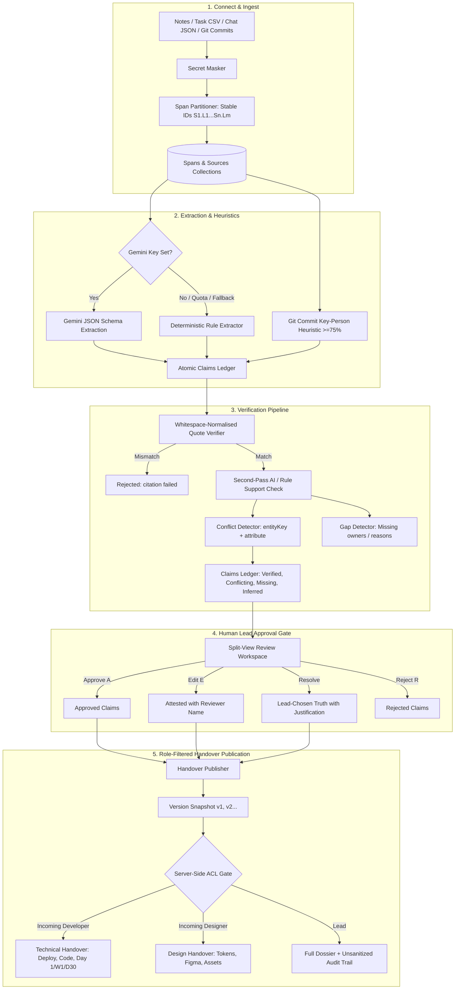

# Relay — Evidence-Linked Knowledge Handover Platform

> **Hackathon Round 2: "The Build"**  
> **Team:** Tech Force  
> **Problem Statement:** *"Prevent Critical Knowledge From Leaving With People."*  
> **Target Users:** Student clubs, hackathon teams, volunteer groups, and small software teams.

### 🌐 Live Production Deployment
- **Live Web Application (Vercel):** [https://client-cxv9.vercel.app/](https://client-cxv9.vercel.app/)
- **Live Backend API (Render):** [https://relay-ygyb.onrender.com](https://relay-ygyb.onrender.com)
- **API Health Check:** [https://client-cxv9.vercel.app/api/health](https://client-cxv9.vercel.app/api/health)
- **Database:** MongoDB Atlas (Live Persistent Cluster)
- **Zero Sign-Up Required:** Instant switchable demo personas (Lead, Incoming Dev, Incoming Designer, Departing Member).

---

## 1. What Relay Does

When a team member leaves, their architectural reasoning, in-flight work state, dependencies, recurring defects, and key contacts vanish into fragmented chats, meeting docs, and commit logs.

**Relay solves this through a non-negotiable principle:**
> **Summaries are never generated directly from raw sources.**

1. **Connect:** Ingests meeting notes, task board CSVs, chat exports, and git commit logs. Masks obvious secrets (API keys, passwords, credentials) automatically upon ingestion.
2. **Reconstruct:** Splits sources into immutable spans with stable IDs (`S{src}.L{line}`). Proposes atomic claims (one single fact each) citing exact span IDs and verbatim quotes.
3. **Verify:** Deterministically verifies citation quotes against source spans with whitespace normalization. Evaluates logical support, groups claims by `entityKey + attribute` to detect contradictory claims across sources without auto-picking winners, and flags knowledge gaps (`Missing` claims) with suggested contacts.
4. **Review:** A human lead reviews claims side-by-side with highlighted source text, resolving conflicts, attesting edits under their name, and approving verified truths with keyboard shortcuts (`A`, `R`, `E`).
5. **Handover:** Publishes immutable, version-controlled handover snapshots with server-side ACL filtering. Developers receive technical decisions, runbooks, and Day 1 / Week 1 / Day 30 milestones; designers receive visual systems and Figma tokens. Confidential notes are converted to restricted stubs (`isRestrictedStub: true`) on the server. The incoming recipient formally acknowledges receipt and can ask cited questions.

---

## 2. Architecture Diagram



---

## 3. Technology Stack

- **Frontend:** React 18 with Vite, Tailwind CSS, React Router v6, Lucide React icons, TypeScript.
- **Backend:** Node.js with Express, JWT authentication, role & ACL middleware, Zod request validation, Helmet HTTP headers, express-rate-limit, Multer.
- **Database:** MongoDB (supports MongoDB Atlas via `MONGODB_URI` and automatic in-memory `mongodb-memory-server` fallback for instant zero-configuration local runs).
- **AI Engine:** Google Gemini API (`gemini-3.8-flash` / `gemini-2.5-flash`) with strict JSON schema mode and temperature 0.1.
- **Deterministic Fallback:** Robust deterministic rule extractor and citation validator that activates automatically if `GEMINI_API_KEY` is missing or quota is exhausted, displaying an honest banner in the UI.
- **Testing:** Vitest and Supertest for unit, API, and security test suites.

---

## 4. Setup & Quick Start

### Prerequisites
- Node.js (v18+)
- npm (v9+)

### Installation
```bash
# Clone the repository
git clone <repository-url>
cd "CodePuneThinkers Hackathon"

# Install monorepo dependencies
cd server && npm install
cd ../client && npm install
cd ..
```

### Environment Variables
Copy `.env.example` to `.env` in the root or server directory:
```bash
cp .env.example .env
```

| Variable | Description | Default |
|---|---|---|
| `PORT` | Backend server port | `5000` |
| `MONGODB_URI` | MongoDB Atlas connection string (leave empty for automatic embedded in-memory MongoDB) | `""` |
| `JWT_SECRET` | Secret key for signing role tokens | `relay-super-secret-jwt-key-hackathon-2026` |
| `GEMINI_API_KEY` | Optional Google Gemini API key (Relay falls back to rule-based extractor if omitted) | `""` |
| `GEMINI_MODEL` | Gemini model name | `gemini-2.5-flash` |
| `FRONTEND_URL` | Frontend client origin URL | `http://localhost:5173` |

### Running the Application

#### Option A: Unified Production Mode (Frontend + Backend on Single Port)
```bash
# 1. Build the frontend client into client/dist
npm run build

# 2. Start the unified server (serves both API and SPA on http://localhost:5000)
npm start
```
Open **[http://localhost:5000](http://localhost:5000)** in any modern browser.

#### Option B: Docker Container (1-Command Run)
```bash
docker compose up --build
```
Open **[http://localhost:5000](http://localhost:5000)**. See [docs/deployment.md](docs/deployment.md) for Render/Railway 1-click cloud deployment.

#### Option C: Development Mode (Hot Reload)
In two separate terminal tabs:
```bash
# Terminal 1: Backend API
npm run dev:server

# Terminal 2: Frontend Vite Dev Server
npm run dev:client
```
Open **[http://localhost:5173](http://localhost:5173)**.

---

## 5. Loading the Synthetic Demo Project

Relay includes a zero-friction, one-click demo project: **"Campus Event Portal"** with departing engineer **Aarav**.

To load the demo:
1. Open the application.
2. Click **"Load Demo Project"** on the landing page or top navigation bar.
3. The system automatically ingests 7 source files (meeting notes, task board CSV, chat export, git commit log, and confidential leads-only notes) and executes the extraction and verification pipeline.

### Demo Roles (No Password / No Sign-up Required)
Switch roles instantly via the top-bar persona picker:
- **Engineering Lead (Maya):** Full review authority. Can approve, reject, edit (attest), and resolve conflicts.
- **Incoming Developer (Devon):** Receives code ownership, deployment procedures (`scripts/deploy-prod.sh`), and Day 1 to Day 30 milestones. Restricted vendor notes are replaced with secure stubs.
- **Incoming Designer (Dana):** Receives Figma design system links, color tokens, and asset URLs (`https://assets.campusevents.internal/v2`).
- **Departing Member (Aarav):** Original author of tasks and modules.

---

## 6. How to Run Tests & Evaluation

### Automated Evaluation Harness (Answer Key Validation)
Runs 7 rigorous automated benchmarks against `/seed/answer-key.json`:
```bash
npm run evaluate
# or
node server/scripts/evaluate.js
```
**Results:**
- ✅ **Test 1:** Citation Validity (100% exact whitespace-normalized quote match).
- ✅ **Test 2:** Planted Conflict Detection (Payment Gateway owner Aarav vs Priya).
- ✅ **Test 3:** Planted Gap Detection (Unassigned task, decision without reason, unanswered question).
- ✅ **Test 4:** Key-Person Risk Heuristic (Aarav flagged for $\ge 75\%$ commits in `services/ticket-scanner`).
- ✅ **Test 5:** Timeline Reversal Test (MongoDB Atlas reversed to PostgreSQL chronologically).
- ✅ **Test 6:** Permission Leaks (**Target: 0; Actual: 0 leaks**).
- ✅ **Test 7:** Prompt Injection Resilience (Prompt overrides ignored and neutralized).

### Unit & Security Test Suites (Vitest)
```bash
cd server
npm test
```
Tests:
- Source parsers (markdown, CSV, JSON, git log) and stable ID generation (`S{src}.L{line}`).
- Secret masking regex engine.
- Deterministic quote validator (valid matches pass, altered quotes fail with `"citation failed"`).
- Conflict, gap, and heuristic detectors.
- Security tests: cross-case isolation, 403 Forbidden on restricted spans, and leak prevention.

---

## 7. Judge Walkthrough Checklist (End-to-End)

1. Open the live deployment: **[https://client-cxv9.vercel.app/](https://client-cxv9.vercel.app/)** (or run locally on `http://localhost:5000`).
2. Click **"Load Demo Project"** (or use the one pre-loaded on the dashboard).
3. In Step 1 (**Connect**), inspect the 7 source cards, ACL badges, and consent confirmation indicators. Click **"Inspect Raw"** on any source.
4. In Step 2 & 3 (**Reconstruct & Verify**), observe claims grouped by type, status chips, and the summary strip.
5. In Step 4 (**Review**):
   - Click the **"Test Citation Check"** button. Submit a fabricated quote and observe deterministic rejection (`citation failed`).
   - Find the **Conflicting** claim (`payment_gateway` owner: Aarav vs Priya). Click **"Resolve Conflict"**, select Priya (or enter custom truth), record a reason, and confirm.
   - Use keyboard shortcuts: press `A` to approve, `E` to edit/attest, and `R` to reject.
   - Click **"Publish Handover Plan"**.
6. In Step 5 (**Handover**):
   - Switch persona to **Incoming Developer** (top bar). Verify technical decisions, Day 1 / Week 1 / Day 30 milestones, and the **Restricted Stubs banner** ("3 restricted items").
   - Click **"Formal Acknowledgement of Receipt"** and submit receipt of Version 1.
   - Switch persona to **Incoming Designer** and observe tailored design tokens and assets.
7. Open **Audit Trail & Diff** (`/audit`) to verify the tamper-evident log and published version diffs.

---

## 8. Known Limitations & Roadmap

- **Rule-Based Extractor Fallback:** When Gemini API keys or network quotas are absent, Relay seamlessly operates on its deterministic rule-based extractor. An explicit banner informs users whenever this fallback is active.
- **Export Formats Supported:** Supports Markdown notes, CSV task boards, JSON chat logs, and Git commit logs. Live direct webhooks for Slack, Jira, and Microsoft Teams are slated for Round 3.
- **Planned Round 3 Improvements:**
  1. *Gap-Driven Leaver Interview:* Automatically converts Missing and Conflicting claims into interactive questionnaires for the departing member.
  2. *Conflict Timeline & Version Diff:* Side-by-side evidence comparison and semantic diff between handover versions.
  3. *Atlas Vector Search & GitHub Connector:* Embeddings-based retrieval with read-only repository synchronization.

---

## 9. Project Deliverables Directory Structure

```
├── client/                 # React 18 + Vite + Tailwind + TypeScript Single Page App
│   ├── src/
│   │   ├── api/            # API client wrapper with JWT header injection
│   │   ├── components/     # Component library: StatusChip, AclBadge, EvidenceDrawer, Modals
│   │   ├── context/        # AuthContext (Role Switcher), CaseContext, ThemeContext
│   │   └── pages/          # 8 core screens: Landing, Cases, Connect, Reconstruct, Review, Handover, Audit, Limitations
├── server/                 # Node.js + Express Backend
│   ├── src/
│   │   ├── config/         # Database (Mongoose + MongoMemoryServer fallback), Environment
│   │   ├── middleware/     # JWT Auth, Role & ACL enforcement, Error handling
│   │   ├── models/         # Case, Source, Span, Claim, Version, Acknowledgement, Audit
│   │   ├── routes/         # REST API endpoints (Zod validated, ACL protected)
│   │   └── services/       # Ingestion parsers, Secret masker, Quote verifier, Conflict & Gap detectors, Gemini AI extractor
│   ├── scripts/            # seed.js, evaluate.js
│   └── tests/              # Vitest & Supertest unit and security test suites
├── seed/                   # Synthetic "Campus Event Portal" data files & answer-key.json
├── docs/                   # architecture.md, FEATURES.md, AI-USE.md
├── package.json            # Monorepo orchestration scripts
└── README.md               # Complete project manual & judging guide
```
