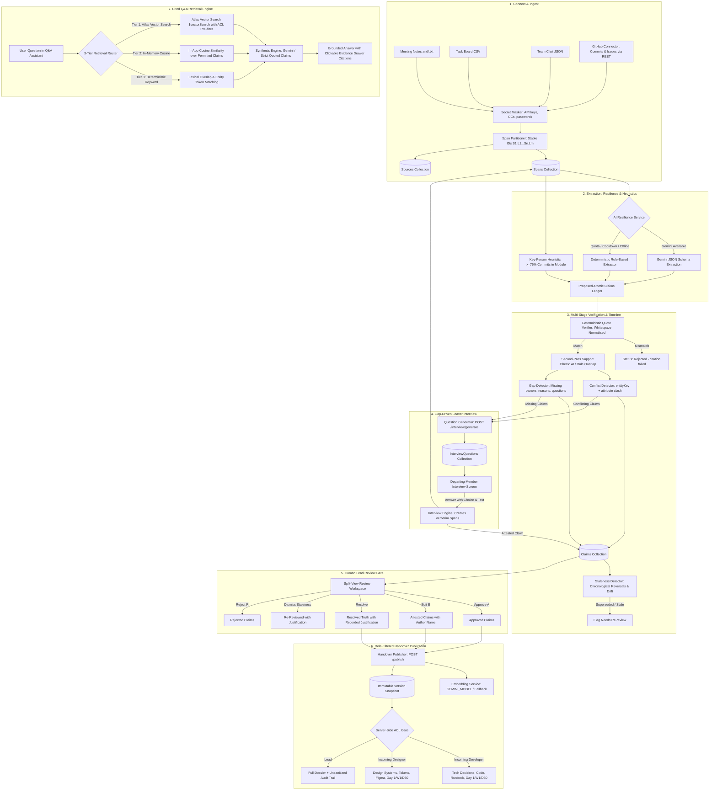
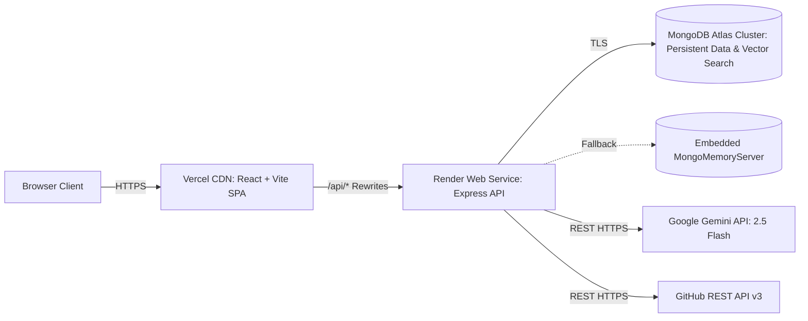

# Relay: Architecture & Data Flow Specification (Round 3)

## 1. Executive Summary & Problem Statement
- **Problem Statement:** *"Prevent Critical Knowledge From Leaving With People."*
- **Team:** Tech Force (We Code Coders / CodePuneThinkers Hackathon)
- **Target Users:** Student clubs, hackathon teams, volunteer groups, and small engineering teams.
- **Core Principle:** Summaries are never generated directly from raw sources. Sources are parsed and partitioned into immutable spans with stable IDs (`S{src}.L{line}`). Atomic claims (one single fact each) cite span IDs and exact verbatim quotes. Code deterministically verifies citations. Models only propose; code and human leads decide. Handover plans are assembled strictly from approved claims within the recipient's permissions.

---

## 2. System Architecture & End-to-End Data Flow



---

## 3. Data Model & Collection Schema Specifications

### 3.1 Claims Collection (`claims`)
```typescript
interface IClaim {
  _id: ObjectId;
  caseId: ObjectId;
  type: 'decision' | 'owner' | 'risk' | 'dependency' | 'blocker' | 'open_question' | 'next_action' | 'problem';
  text: string;
  entityKey: string;
  attribute: string;
  value: string;
  confidence: number;
  status: 'Verified' | 'Attested' | 'Inferred' | 'Conflicting' | 'Missing' | 'Restricted' | 'Rejected';
  accessLabel: 'team' | 'leads_only' | 'owner_only';
  spans: Array<{
    spanId: string;
    quote: string;
    verified: boolean;
    verificationReason?: string;
  }>;
  reviewDecision: 'pending' | 'approved' | 'rejected' | 'modified';
  reviewedBy?: string;
  reviewedAt?: Date;
  attestedBy?: string;
  resolutionNote?: string;
  // Round 3 Staleness & Timeline Additions
  stalenessStatus?: 'current' | 'possibly_stale' | 'superseded';
  stalenessReason?: string;
  supersededBy?: ObjectId;
  evidenceDate?: Date;
  isDateEstimated?: boolean;
  timelineCategory?: 'decision' | 'ownership' | 'conflict' | 'reversal' | 'milestone';
  stalenessDismissed?: boolean;
  stalenessDismissedBy?: string;
  stalenessDismissedAt?: Date;
  stalenessDismissalReason?: string;
  // Round 3 Vector Search Additions
  embedding?: number[];
  embeddingModel?: string;
  embeddedAt?: Date;
}
```

### 3.2 Interview Questions Collection (`interview_questions`)
```typescript
interface IInterviewQuestion {
  _id: ObjectId;
  caseId: ObjectId;
  targetClaimId: ObjectId;
  type: 'missing_owner' | 'decision_rationale' | 'unanswered_question' | 'conflict_resolution' | 'missing_dependency';
  prompt: string;
  contextSnippet?: string;
  suggestedContact?: string;
  status: 'open' | 'answered' | 'skipped' | 'reassigned';
  answerText?: string;
  selectedOption?: string;
  author?: string;
  accessLabel: 'team' | 'leads_only';
  answeredAt?: Date;
  createdSpanId?: string;
  createdClaimId?: ObjectId;
  options?: Array<{ label: string; value: string; sourceTitle?: string }>;
}
```

### 3.3 Sources & Spans Collection (`sources`, `spans`)
- `sources`: Stores ingested files, pasted text, and GitHub repository sync metadata. Type includes `meeting_notes`, `task_board`, `chat_export`, `git_commit_log`, `interview`, `repo_export`.
- `spans`: Stores atomic text blocks with stable identifiers (`S{srcIndex}.L{lineIndex}`), author, timestamp, line numbers, and clean text (with sensitive credentials masked).

### 3.4 Handover Snapshots (`versions`) & Audit Log (`audits`)
- `versions`: Immutable numbered handover plans (`v1`, `v2`, ...) containing approved claims snapshot, version diff metrics (`added`, `modified`, `removed`), Day 1 / Week 1 / Day 30 milestones, and publisher metadata.
- `audits`: Tamper-evident event log recording user actions (`upload`, `reconstruct`, `approve`, `reject`, `edit`, `resolve`, `publish`, `acknowledge`, `github_import`, `interview_answer`, `dismiss_staleness`). Raw credentials or leads-only text are sanitized prior to logging.

---

## 4. Multi-Stage Extraction, Resilience & Verification Pipeline

### 4.1 AI Resilience & Back-off Architecture (`aiResilience.js`)
To guarantee Relay functions reliably during hackathon judging and live demonstrations without hard dependency on external AI availability:
1. **Exponential Back-Off:** Failed Gemini calls retry up to 2 times with jittered exponential back-off (1s, 2s).
2. **Per-Request Timeout:** Every external call is bounded by a strict 6,000ms timeout using `AbortController`.
3. **Automatic Circuit-Breaker Cooldown:** When quota or consecutive API errors occur (HTTP 429 / 503), the engine transitions into a 60-second cooldown period. Subsequent extraction requests bypass Gemini instantly and execute via the deterministic rule-based extractor.
4. **Transparent Status Reporting:** The API response and frontend UI explicitly display which extractor processed the data (`Gemini 2.5 Flash` or `Deterministic Rule Extractor`) and why.

### 4.2 Deterministic Verification Invariant
> **Trust comes from code, never models.**
- A claim is verified if and only if:
  1. The cited `spanId` exists in the database.
  2. The cited `quote` is found as a substring within that span's text after whitespace normalization (`normalizeWhitespace(str)`).
  3. If quote matching fails, the claim is rejected with reason `"citation failed"`.
- Second-pass logical support check verifies whether the quote genuinely asserts the extracted claim. If the model or rule checker detects discrepancy, the claim is demoted to `Inferred` or rejected.

---

## 5. Improvement 1: Gap-Driven Leaver Interview Architecture

1. **Question Generation Engine (`interviewEngine.js`):**
   - Automatically inspects all claims in `status: 'Missing'` and `status: 'Conflicting'`.
   - Generates templated, deterministic questions:
     - Missing Owner: *"Who owns <task>, and what is its current state?"*
     - Decision without Reason: *"Why was <decision> chosen, and what alternatives were rejected?"*
     - Unanswered Question: *"Do you know the answer to: <question>?"*
     - Conflict: *"Sources disagree about <entity>: <value A> vs <value B>. Which is correct, and why?"*
   - Idempotent: Re-running question generation preserves previously answered questions.
2. **Leaver Interface & Evidence Transformation:**
   - Departing member responds via dedicated `/cases/:id/interview` interface with single-question progress stepper or full list.
   - For conflicts, leaver clicks option buttons (`Aarav` vs `Priya`) and enters rationale.
   - On submission:
     1. Creates a new verbatim span in a designated `interview` source (`[Interview Attestation]: <text>`).
     2. Generates an `Attested` claim linked to the target gap/conflict.
     3. Quote verifier validates that the claim's citation matches the freshly generated span with 100% precision.
3. **Lead Approval Gate:**
   - The attested claim enters the Review workspace labeled *"From leaver interview"*.
   - Lead can Approve, Edit, or Reject. A resolved conflict claim supersedes the conflicting claim once approved.

---

## 6. Improvement 2: GitHub Connector & 3-Tier Vector Q&A Architecture

### 6.1 Read-Only GitHub Connector (`githubConnector.js`)
- **Strict SSRF Sanitization:** Regex validation enforces `^https://github.com/[A-Za-z0-9_.-]+/[A-Za-z0-9_.-]+$`. No external hostnames, loopback addresses, or internal networks can be requested.
- **REST API Read-Only Ingestion:** Fetches latest 100 commits and 50 issues via GitHub REST API v3 using optional `GITHUB_TOKEN`.
- **Repo Export Parser:** Compiles commits (`sha date author: message`) and issues (`#n [state] title: body`) into a clean markdown document.
- **Key-Person Risk Derivation:** Derives module names from conventional commit scopes (e.g. `feat(scanner): ...` $\to$ module `scanner`) or colon prefixes.
- **Idempotency:** Re-importing a repository replaces the previous export source and its derived spans rather than duplicating.

### 6.2 3-Tier Q&A Retrieval Engine (`embeddingService.js`)
To provide reliable answers citing exact approved claims while preventing single-point failure:
- **Tier 1: Atlas Vector Search (`$vectorSearch`):**
  - Executes vector search index across pre-filtered permitted claims:
    ```javascript
    {
      $vectorSearch: {
        index: "claim_vector_index",
        path: "embedding",
        queryVector: queryEmbedding,
        numCandidates: 50,
        limit: 5,
        filter: {
          caseId: new ObjectId(caseId),
          accessLabel: { $in: permittedAcls },
          reviewDecision: "approved"
        }
      }
    }
    ```
- **Tier 2: In-App Cosine Similarity:**
  - Evaluates dot-product cosine similarity over in-memory vectors of permitted, approved claims.
- **Tier 3: Deterministic Keyword Matching:**
  - Tokenizes question text, calculates lexical overlap against approved claims, and ranks by relevance.
- **UI Transparency:** The Q&A panel explicitly renders an active badge indicating the retrieval mode used (`Atlas Vector Search`, `In-app similarity`, or `Keyword`) and clickable citation pills that open the Evidence Drawer.

---

## 7. Improvement 3: Conflict Timeline & Staleness Detection Architecture

### 7.1 Temporal Alignment & Date Parsing
- Derives evidence timestamps from git commits, chat timestamps, and ISO dates in notes.
- Falls back to source upload timestamp if no date is present, marked `isDateEstimated: true`.

### 7.2 Staleness Detector (`stalenessDetector.js`)
- **Chronological Decision Reversals:** Analyzes sequential claims sharing identical entity keys and attributes. Flags earlier claims as `superseded` when a later source contains reversal markers (*"reversed"*, *"replaced"*, *"switched"*, *"instead of"*, *"no longer"*).
- **Side-by-Side Conflict Cards:** Displays competing claims chronologically, highlighting the newer source badge.
- **Republish Blocking:** Stale and superseded claims block unchanged republishing until the lead either re-reviews, updates, or dismisses the flag with a mandatory recorded justification.

---

## 8. Permission Model & Server-Side Security Invariant

> **Restricted content must never appear in API responses, logs, prompts, or embeddings visible to a role that cannot see it.**

| Role | Permitted ACL Labels | Allowed Actions | Restricted View Behavior |
|---|---|---|---|
| **Lead** (`lead`) | `['team', 'leads_only', 'owner_only']` | Ingest, Reconstruct, Review, Resolve, Publish, Dismiss Staleness, View Full Dossier & Unsanitized Audits | Full unrestricted access |
| **Incoming Developer** (`incoming_dev`) | `['team']` | View Published Handover, Ask Q&A, Acknowledge Receipt | Restricted claims rendered as stubs (`isRestrictedStub: true`). Zero confidential text returned. |
| **Incoming Designer** (`incoming_designer`) | `['team']` | View Published Handover (Design Tokens & Assets), Ask Q&A, Acknowledge Receipt | Same strict team-only ACL gate. |
| **Departing Member** (`departing`) | `['team', 'owner_only']` | View Assigned Tasks, Complete Leaver Interview, Attest Spans | Restricted leads-only questions or spans withheld. |

---

## 9. Deployment Topology & Environments



- **Frontend:** Hosted on Vercel (`https://client-cxv9.vercel.app/`). Proxies `/api/*` to Render backend via `vercel.json` rewrites.
- **Backend:** Hosted on Render (`https://relay-ygyb.onrender.com`). Configured with health check (`/api/health`), cold-start handling, and CORS origins.
- **Database:** MongoDB Atlas primary cluster with automated in-memory MongoDB fallback for instantaneous offline development and test execution.
