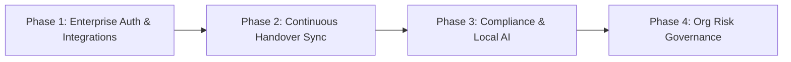

# Relay: Post-Hackathon Product Roadmap

This document outlines the ordered architectural and product roadmap for Relay following the completion of Round 3 ("The Build"). Each milestone defines target users, required technical components, security considerations, and priority rankings.

---

## Roadmap Overview & Prioritization

| Phase | Milestone | Priority | Target Audience | Key Capabilities |
|---|---|:---:|---|---|
| **Phase 1** | Enterprise SSO & Workplace Connectors | P0 | Engineering Orgs & University Labs | Okta/SAML, Live Slack & Teams connectors with admin approval |
| **Phase 2** | Continuous Handover & Bi-Directional Sync | P1 | Fast-Moving Software Teams | Scheduled cron refreshes, Git webhook sync, Jira/Linear task resolution |
| **Phase 3** | Compliance, PDF Export & Local Models | P1 | Healthcare, Defense & Regulated Enterprises | Cryptographic PDF dossier export, Air-gapped Ollama / vLLM integration |
| **Phase 4** | Org-Wide Knowledge & Ownership Intelligence | P2 | CTOs, VP Engineering, HR Operations | Cross-project single-point-of-failure heatmaps, automated leaver offboarding |

---

## Phase 1: Enterprise SSO & Workplace Connectors (P0 — Immediate Next Step)

### 1.1 Live Slack & Microsoft Teams Connectors
- **Who It Is For:** Software teams where operational decisions happen in ephemeral channels rather than formal documentation.
- **What It Takes:**
  - Dedicated Slack App and Microsoft Teams bot registering webhooks for consented channels.
  - Granular OAuth2 permission flows requiring workspace administrator approval.
  - Secret scanning and PII scrubbing prior to channel ingestion.
  - Automatic thread grouping: converts decision threads into structured spans while filtering conversational noise.
- **Security & Privacy:** Server-side ACL binding ensuring channel privacy levels (e.g. private channel vs public channel) map deterministically to Relay access labels (`team` vs `leads_only`).

### 1.2 Enterprise SSO (SAML 2.0 & OIDC)
- **Who It Is For:** Organizations requiring centralized identity lifecycle management.
- **What It Takes:**
  - Integration with Okta, Azure Active Directory / Entra ID, and Google Workspace via SAML 2.0 / OpenID Connect.
  - Automatic role mapping: maps directory groups (e.g. `engineering-leads`, `contractors`, `interns`) directly to Relay roles (`lead`, `incoming_dev`, `departing`).
  - Automated session termination upon directory de-provisioning.

---

## Phase 2: Continuous Handover & Bi-Directional Sync (P1 — Q1 2027)

### 2.1 Scheduled Handover Refreshes & Git Webhooks
- **Who It Is For:** Engineering managers managing high-turnover student teams or rotating interns.
- **What It Takes:**
  - GitHub & GitLab webhook listeners triggered on branch merges (`main`, `master`).
  - Background worker evaluating commit messages and PR summaries for architectural decisions or module ownership shifts.
  - Proposes automated "Handover Diffs" in draft status, notifying the lead when key-person risk thresholds ($\ge 75\%$ module authoring) are breached.

### 2.2 Jira & Linear Connectors
- **Who It Is For:** Agile development squads tracking tasks and technical debt across project boards.
- **What It Takes:**
  - Two-way synchronization with Jira Cloud REST API and Linear GraphQL API.
  - Automatically identifies orphaned tickets when an assignee's offboarding begins.
  - Auto-converts ticket acceptance criteria and resolution notes into verified handover claims.

---

## Phase 3: Compliance, PDF Export & Air-Gapped AI (P1 — Q2 2027)

### 3.1 Cryptographically Signed PDF Handover Dossiers
- **Who It Is For:** Legal departments, defense contractors, and university grant administrators requiring immutable offline compliance records.
- **What It Takes:**
  - Headless Puppeteer / React PDF rendering pipeline generating audit-grade PDF documents.
  - Embeds SHA-256 content hashes, publisher signatures, recipient acknowledgements, and full citation appendices linking claims to verbatim source line numbers.
  - Strict role-based rendering preventing leads-only notes from leaking onto exported developer dossiers.

### 3.2 Local & Air-Gapped LLM Execution (Ollama / vLLM)
- **Who It Is For:** Regulated defense, healthcare, and banking environments prohibiting cloud API egress.
- **What It Takes:**
  - Pluggable LLM connector interface supporting local OpenAI-compatible endpoints (`http://localhost:11434/v1`).
  - Optimized support for quantized open-weights models (e.g. Llama 3 8B, Qwen 2.5 Coder, Mistral NeMo).
  - Preserves Relay's strict JSON schema extraction and zero-hallucination verification invariant entirely within the private VPC.

---

## Phase 4: Enterprise Knowledge Governance & Risk Intelligence (P2 — Q3 2027)

### 4.1 Cross-Project Key-Person Risk Matrix
- **Who It Is For:** VP Engineering and Chief Technology Officers overseeing multi-repo organizations.
- **What It Takes:**
  - Multi-case aggregation engine tracking author commits and task ownership across all company repositories.
  - Heatmap dashboard highlighting critical single points of failure before departure notices occur.
  - Automated leaver simulation: calculates how much knowledge would remain verified vs missing if a given engineer were to depart today.

### 4.2 Interactive Offboarding Copilot
- **Who It Is For:** Departing team members during their final 2 weeks.
- **What It Takes:**
  - Conversational AI agent walking the leaver through incomplete tasks, unexplained architectural decisions, and emergency runbooks.
  - Automatically schedules handover syncs and verifies that incoming team members have exercised critical runbooks before sign-off.
