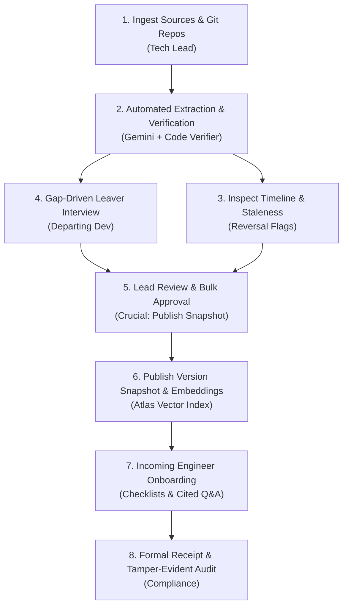

# Relay: Engineering Operational & Implementation Guide
*A Practical Field Guide for Software Engineering Teams, Leads, and Onboarding Developers*

---

## 1. Executive Summary & The Relay Mental Model

Traditional software handovers fail because they rely on ad-hoc meetings and stale Google Docs, or worse, raw LLM summaries that hallucinate, omit critical context, and leak permissions. 

**Relay transforms handover into a verifiable, multi-actor software pipeline:**

```
┌────────────────────────────────────────────────────────────────────────────────────────┐
│                                 THE RELAY MENTAL MODEL                                 │
├─────────────────┬──────────────────────────────────────────────────────────────────────┤
│ 1. Immutable    │ Sources are split into permanent line-level spans (S1.L4).           │
│    Spans        │ Text is treated as inert data; secrets/PII are masked at ingestion.  │
├─────────────────┼──────────────────────────────────────────────────────────────────────┤
│ 2. Atomic       │ Every fact (decision, owner, risk, gap) is an individual claim       │
│    Claims       │ bound to exact source spans. Status is governed by strict code rules.│
├─────────────────┼──────────────────────────────────────────────────────────────────────┤
│ 3. Human & Code │ AI models propose claims; deterministic string-matching code and     │
│    Gate           engineering leads decide what is Verified, Attested, or Published.   │
├─────────────────┼──────────────────────────────────────────────────────────────────────┤
│ 4. Role-Based   │ Access control (ACL) is enforced on the server for all endpoints,    │
│    Security     │ timeline events, interview questions, and vector embeddings.         │
└─────────────────┴──────────────────────────────────────────────────────────────────────┘
```

---

## 2. Team Personas & Roles

Relay recognizes three operational personas in any engineering handover:

| Persona | Real-World Role | Primary Responsibilities in Relay |
| :--- | :--- | :--- |
| **Engineering Lead / Architect** | Tech Lead, Staff Engineer, or Manager | Initiates cases, connects repos/notes, triggers reconstruction, reviews claims, resolves conflicts, dismisses/updates stale claims, publishes versions. |
| **Departing Engineer (Leaver)** | Outgoing Senior/Staff/Contractor | Answers targeted gap & conflict questions generated by Relay; provides reasoning not captured in files; submits verbatim Attested claims. |
| **Incoming Engineer (Joiner)** | New Hire, Transfer, or Team Successor | Consumes Day 1 / Week 1 / Day 30 milestones; inspects technical runbooks; queries the cited 3-tier Vector Q&A assistant; formally acknowledges receipt. |

---

## 3. Step-by-Step Engineering Workflow



---

### Phase 1: Case Initialization & Source Ingestion (Tech Lead)
*Goal: Ingest raw artifacts from the departing engineer's project into immutable spans.*

1. **Sign In**: Navigate to `/login` and authenticate as the Engineering Lead (or use **One-Click Judge Login** with `demo@techforce.dev` / `Demo@1234`).
2. **Create or Open a Case**: Go to `/cases`. Click **"Create Case"** (e.g., `Payment Gateway Service Handover`) or click **"Load Demo Project"** to test with pre-seeded data.
3. **Connect Data Sources (`/connect`)**:
   - **File Upload / Paste**: Upload or paste meeting notes (`.md`), task exports (`.csv`), team chat logs (`.json`), or architecture decisions (`.txt`).
   - **Public GitHub Import**:
     - Paste a repository URL (e.g., `https://github.com/owner/service-repo`).
     - Check the authorization consent box.
     - Select an Access Label (`team` or `leads_only`).
     - Click **"Import Repository"**.
4. **Behind the Scenes**:
   - The server validates the GitHub URL against strict SSRF regex rules.
   - PII and credentials (API keys, bearer tokens, emails) are masked automatically.
   - Every text file, commit, and issue is indexed into immutable spans (`S1.L1` to `S1.L150`).

---

### Phase 2: Reconstruction & Code-Level Verification (Automated)
*Goal: Transform passive raw text into atomic, verifiable knowledge units.*

1. **Trigger Reconstruction (`/reconstruct`)**:
   - Click **"Reconstruct & Verify"**.
   - Gemini 2.5 Flash runs in structured JSON schema mode (or fails gracefully to the rule-based extractor if offline or quota-limited).
2. **Review Extracted Claims**:
   - Claims are categorized: *Decisions*, *Ownership*, *Risks*, *Dependencies*, *Gaps*, and *Actions*.
   - Each claim displays a **Status Badge**:
     - `Verified`: The exact quote was validated in source code by Relay's string matcher.
     - `Conflicting`: Multiple sources assert contradictory values (e.g., different owners or architectures).
     - `Missing`: An identified gap (e.g., an unassigned production task or a decision without rationale).
     - `Inferred`: Deduced from commit scope activity (e.g., single-author module concentration).
3. **Inspect Key-Person Risk**:
   - If a developer authored $\ge 75\%$ of commits in a module, Relay flags a Key-Person Risk card (e.g., *"Aarav authored 83.3% of commits in services/ticket-scanner"*).

---

### Phase 3: Timeline Analysis & Staleness Detection (Tech Lead)
*Goal: Understand the chronological evolution of decisions and catch superseded facts.*

1. **Open Timeline Screen (`/timeline`)**:
   - View an interactive chronological feed of all project milestones, commits, decisions, and conflicts.
   - Filter by category (*Decisions*, *Ownership*, *Conflicts*, *Milestones*).
2. **Inspect Side-by-Side Conflicts**:
   - Conflicting claims render as comparison cards:
     - **Source A**: Quote, file name, timestamp.
     - **Source B**: Quote, file name, timestamp.
     - A green **"Newer Source"** badge highlights which statement is more recent.
3. **Inspect Staleness & Reversals**:
   - If a decision was reversed later in time (e.g., *"Sep 1: Use MongoDB Atlas"* reversed by *"Oct 20: Switched to PostgreSQL"*), Relay marks the older claim as `superseded`.
   - **Republish Blocking**: Stale claims cannot be silently published. The lead must re-review or provide a documented dismissal reason.

---

### Phase 4: Capturing Tacit Knowledge via Leaver Interview (Departing Engineer)
*Goal: Extract unspoken context and rationale directly from the outgoing developer.*

1. **Role Switch / Sign In**:
   - Sign in as the Departing Member (e.g., `departing@relay.demo` / `relay2026!`).
2. **Open Interview Workspace (`/interview`)**:
   - Relay automatically generates targeted questions from all `Missing` claims and `Conflicting` claims.
3. **Answering Questions**:
   - **For Missing Owners / Runbooks**: The leaver fills in the missing operational details.
   - **For Conflicts**: The leaver clicks a quick-pick button to declare which source is accurate, then adds a brief rationale.
   - **Skip / Not Sure**: Questions can be skipped or reassigned to other team members without breaking the flow.
4. **Behind the Scenes**:
   - The leaver's answers are saved as permanent spans in a dedicated `interview` source.
   - An `Attested` claim is generated citing the leaver's verbatim response.
   - Zero confidential (`leads_only`) claims are ever revealed to the leaver during the interview.

---

### Phase 5: Lead Review, Approval & Publication Gate (CRITICAL STEP)
*Goal: Final human-in-the-loop audit to convert pending claims into approved, searchable handover knowledge.*

> [!IMPORTANT]
> **Why the Approval Gate Matters for Q&A:**
> When claims are first extracted in Step 2, they start in `pending` review status. Relay's Q&A engine strictly adheres to the rule:
> **"Answers are synthesized ONLY from APPROVED claims within your permission scope."**
> If you query the Q&A Assistant while claims are pending, it will correctly answer: *"I could not find this in the approved handover."*
> To make claims searchable by the incoming team, the Lead **must approve and publish** them!

1. **Open Review Workspace (`/review`)**:
   - Claims are listed side-by-side with an interactive **Evidence Drawer**.
   - Answers from the departing engineer appear tagged with a distinct badge: **"From leaver interview"**.
2. **Lead Actions**:
   - **Bulk Approve Verified**: Click the **"Bulk Approve Verified"** button at the top of the Review page to instantly approve all deterministic, citation-verified claims.
   - **Keyboard Shortcuts**: Use <kbd>A</kbd> to Approve, <kbd>R</kbd> to Reject, <kbd>E</kbd> to Edit individual claims.
   - **Resolve Conflicts**: Pick the winning value for conflicts and record the engineering rationale.
   - **Test Citation Check**: Enter a fabricated quote to verify that Relay's code gate rejects altered citations.
3. **Publish Handover Version**:
   - Click **"Publish Handover Plan"** in the top right.
   - An immutable version snapshot is created with added, modified, and removed diff counts.
   - **Automatic Embedding**: Relay embeds all approved claims using Gemini embeddings (`text-embedding-004`) and updates the Atlas Vector Search index.

---

### Phase 6: Joiner Onboarding & 3-Tier Vector Q&A (Incoming Engineer)
*Goal: Empower the new developer with clear milestones and grounded, hallucination-free assistance.*

1. **Sign In as Incoming Developer**:
   - Authenticate as Incoming Developer (`incoming_dev@relay.demo` / `relay2026!`).
2. **Open Handover Workspace (`/handover`)**:
   - **Action Plan**: Immediate **Day 1**, **Week 1**, and **Day 30** checklists.
   - **Role Filtering**: The developer sees technical architecture and runbooks; designers see Figma links and design tokens; restricted strategic notes are rendered only as secure counted stubs (e.g., *"3 restricted claims exist — contact Maya"*).
3. **Interactive Cited Q&A Assistant**:
   - Incoming engineers ask natural-language questions (e.g., *"how is deployment handled"* or *"Why did we choose PostgreSQL?"*).
   - **3-Tier Grounded Retrieval**:
     1. *Tier 1: Atlas Vector Search* (`$vectorSearch` pre-filtered on permissions).
     2. *Tier 2: In-App Cosine Similarity* (over permitted approved claims).
     3. *Tier 3: Lexical Keyword Matching* (deterministic fallback).
   - **Verifiable Citations**: Every answer cites approved claims with clickable pills that open the exact source span in the Evidence Drawer.
   - **Guaranteed Zero Leaks**: If a junior engineer asks about confidential strategy or compensation, the assistant replies: *"I could not find this in the approved handover."*

---

### Phase 7: Formal Receipt & Audit Compliance
*Goal: Close the accountability loop and maintain an enterprise audit trail.*

1. **Acknowledge Handover**:
   - The incoming engineer clicks **"Acknowledge Handover"** to confirm they have reviewed the documentation and runbooks.
   - Any remaining questions are recorded back to the lead.
2. **Inspect Audit Log (`/audit`)**:
   - A chronological, tamper-evident log records every action: source ingestion, claim approval, conflict resolution, interview answers, staleness dismissals, and publication events.

---

## 4. Troubleshooting & FAQ for Teams

| Question / Symptom | Cause | Solution |
| :--- | :--- | :--- |
| **Why did Q&A answer "I could not find this in the approved handover"?** | Claims were reconstructed but remain `pending` review. The sidebar shows `[ N pending ]`. | Go to **Step 5: Review**, click **"Bulk Approve Verified"**, and click **"Publish Handover Plan"**. Once published, Q&A answers instantly. |
| **Why does the initial page load take ~30-45 seconds?** | Render free-tier backend services spin down after 15 min of inactivity. | Relay features an auto-reconnecting wake-up banner. Simply wait for the server to boot once; subsequent requests are immediate. |
| **Why was my modified citation rejected in Review?** | Relay's code-level verifier normalizes whitespace and matches the exact source span. | Claims can only cite real, unaltered quotes. If a lead needs to summarize without an exact quote, use **Edit / Attest (<kbd>E</kbd>)** to record a lead attestation. |
| **Can departing engineers see confidential strategy questions?** | No. Server-side ACL filtering scrubs `leads_only` claims before generating questions. | Leavers only see questions derived from `team` scope claims. Confidential claims remain restricted to leads. |

---

## 5. Summary Cheat Sheet for Presentations & Demos

| Step | Page / URL | Primary Action | Value Proposition |
| :---: | :--- | :--- | :--- |
| **1** | `/login` | Click **"One-Click Judge Login"** | Instant evaluation with zero typing (`demo@techforce.dev` / `Demo@1234`) |
| **2** | `/cases` | Click **"Load Demo Project"** | Pre-seeded with 7 realistic sources and 6 edge cases |
| **3** | `/reconstruct` | Click **"Reconstruct & Verify"** | Verifiable claims bound to line-level code citations |
| **4** | `/timeline` | Filter by Conflicts & Decisions | Side-by-side comparison with automatic staleness flags |
| **5** | `/interview` | Switch to Leaver, answer questions | Unwritten tacit knowledge converted to Attested claims |
| **6** | `/review` | **Bulk Approve & Publish** | Lead gate converts pending claims to published, searchable knowledge |
| **7** | `/handover` | Switch to Joiner, ask Q&A | 3-tier vector search with 0 ACL leaks and exact citations |
| **8** | `/audit` | Review chronological log | Complete auditability and receipt acknowledgement |
