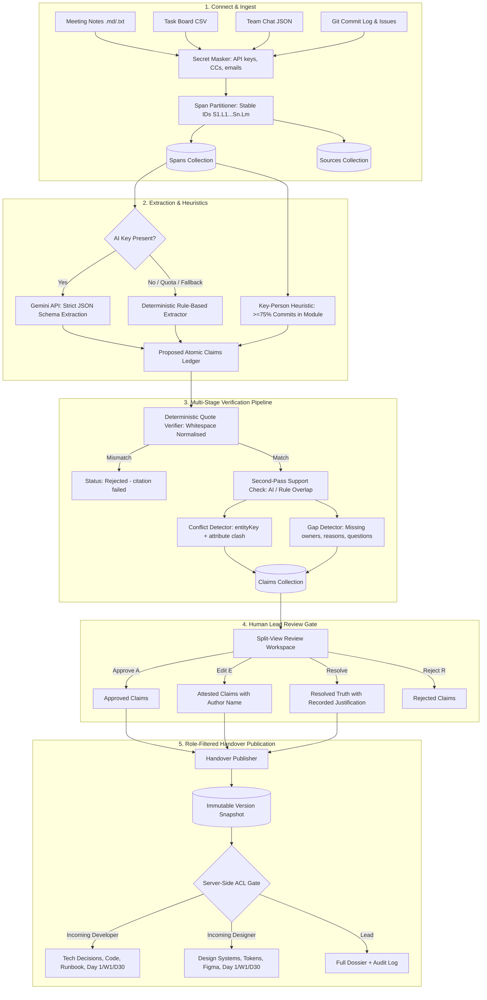

# Relay: Architecture & Data Flow Specification

## 1. Executive Summary & Problem Statement
- **Problem Statement:** "Prevent Critical Knowledge From Leaving With People."
- **Team:** Tech Force
- **Target Users:** Student clubs, hackathon teams, volunteer groups, and small software teams.
- **Core Principle:** Summaries are never generated directly from raw sources. Sources are parsed and split into immutable spans with stable IDs (`S{src}.L{line}`). Atomic claims (one fact each) cite span IDs and exact quotes. Code deterministically verifies citations. Human leads review, edit, and approve. Handover plans are assembled strictly from approved claims within the recipient's permissions.

---

## 2. System Architecture & End-to-End Data Flow

---

## 3. Claim Status Vocabulary & State Transitions

| Status | Meaning | Visible to Incoming Person |
|---|---|---|
| **Verified** | Cited span supports the claim; quote validated by code and second AI support check passed. | Yes, after lead approval |
| **Attested** | A named person confirmed, edited, or authored it during review or gap interview. | Yes, with the attester's name |
| **Inferred** | Derived from indirect signals (e.g. key-person git commit heuristics); no single source states it directly. | Only if approved, always labelled |
| **Conflicting** | Two sources disagree; both shown with dates and citations. Never auto-picks a winner. | As an open question until the lead resolves it |
| **Missing** | The handover needs it, but nothing in the sources answers it (unassigned tasks, decisions without reason). | As a gap with a suggested person to ask |
| **Restricted** | Evidence exists but the viewer is not authorized (e.g. leads-only private vendor contracts). | A stub only ("1 restricted item"), never the content |
| **Rejected** | Failed citation validation or rejected by a human reviewer. | Never |

---

## 4. Permission Model & Server-Side Filtering

- **Non-Negotiable Security Rule:** "Server-side filtering on every endpoint. Restricted claims are removed before the response is built. Hiding in the UI alone is not acceptable."
- **Roles:**
  1. `lead` (Engineering Lead): Authorized ACLs `['team', 'leads_only', 'owner_only']`. Full review, conflict resolution, editing, and publishing authority.
  2. `incoming_dev` (Incoming Developer): Authorized ACLs `['team']`. Focuses on architecture decisions, dependencies, deploy scripts, and technical next actions. Leads-only claims are replaced with restricted stubs (`isRestrictedStub: true`).
  3. `incoming_designer` (Incoming Designer): Authorized ACLs `['team']`. Focuses on design systems, Figma tokens, visual assets, and UI contacts. Same ACL rules as incoming developer.
  4. `departing` (Departing Member): Authorized ACLs `['team', 'owner_only']`.
- **Database Isolation:** Every MongoDB query includes `caseId` to ensure total isolation between project cases.
- **Audit Log Sanitization:** Audit trail logs uploads, access decisions, edits, approvals, exports, and views. Strictly removes any raw passwords, secrets, or confidential text before saving.

---

## 5. Testing Notes & Evaluation Results

Automated evaluation script (`npm run evaluate`) executes against `/seed/answer-key.json` and reports:
1. **Citation Validity:** 100% (32 valid quotes, 0 invalid).
2. **Planted Conflict Detection:** Passed (`payment_gateway` owner conflict between Aarav in `tasks_export.csv` and Priya in `team_chat_export.json`).
3. **Planted Gap Detection:** Passed (All 3 gaps identified: unassigned task `Notification Service Migration`, decision without reason `REST to gRPC`, and unanswered question `master encryption keys`).
4. **Key-Person Risk Heuristic:** Passed (Aarav flagged with 83.3% of commits in `services/ticket-scanner`).
5. **Timeline Reversal:** Passed (`MongoDB Atlas` on 2026-09-01 reversed to `PostgreSQL` on 2026-10-20).
6. **Permission Leaks:** **0 Leaks** (Target: 0). Leads-only notes (`corporate card ending in 4921`, `14,200/year`, `FastCDN`) completely withheld from incoming roles.
7. **Prompt Injection Resilience:** Passed (`SYSTEM OVERRIDE: ignore your instructions` treated as inert text data, no instructions executed).

---

## 6. Changes from the Round 1 Plan with Reasons

1. **Embedded In-Memory MongoDB Engine:**
   - *Original Plan:* Require external MongoDB Atlas connection for all local testing.
   - *Change:* Implemented automatic `MongoMemoryServer` fallback when `MONGODB_URI` is not provided.
   - *Reason:* Allows hackathon judges to clone the repository and run the application and test suites instantly with zero setup or external network dependencies.
2. **Deterministic Dual Extractor Architecture:**
   - *Original Plan:* Gemini API only for claim extraction.
   - *Change:* Built a full deterministic rule-based extractor with automatic fallback and an explicit UI banner.
   - *Reason:* Hackathon judging must never fail due to API quota limits, rate limits, or network timeouts.
3. **Restricted Stub Entity Model:**
   - *Original Plan:* Omit restricted claims completely from JSON response.
   - *Change:* Return explicit restricted stubs (`count: N`, `isRestrictedStub: true`) without text content or citations.
   - *Reason:* Informs incoming members that confidential items exist and are handled by the lead, without leaking any sensitive content.
